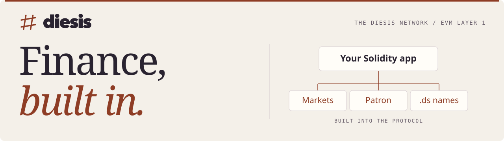

<picture>
  <source media="(prefers-color-scheme: dark) and (max-width: 640px)" srcset="https://raw.githubusercontent.com/0xDiesis/.github/main/profile/assets/finance-mobile-dark.svg">
  <source media="(max-width: 640px)" srcset="https://raw.githubusercontent.com/0xDiesis/.github/main/profile/assets/finance-mobile-light.svg">
  <source media="(prefers-color-scheme: dark)" srcset="https://raw.githubusercontent.com/0xDiesis/.github/main/profile/assets/finance-dark.svg">
  <source media="(prefers-color-scheme: light)" srcset="https://raw.githubusercontent.com/0xDiesis/.github/main/profile/assets/finance-light.svg">
  
</picture>

<p align="center">
  <a href="#start-building"><b>Start building</b></a> &nbsp; / &nbsp;
  <a href="#built-into-the-chain">Native services</a> &nbsp; / &nbsp;
  <a href="#explore-the-implementation">Protocol code</a> &nbsp; / &nbsp;
  <a href="#contribute">Contribute</a>
</p>

**Build financial apps on an EVM Layer 1 with native trading, sponsored fees, and readable names.** Use Solidity, Ethereum JSON-RPC, and your existing Ethereum libraries.

## Start building

| What you want to build | Start here |
| :--- | :--- |
| **An app, service, or trading bot** | [TypeScript](https://github.com/0xDiesis/diesis-js#readme) with viem or [Python](https://github.com/0xDiesis/diesis-py#readme) with web3.py. Both include native RPC actions and signing helpers. |
| **A smart contract** | [Solidity interfaces](https://github.com/0xDiesis/diesis-sol#readme) for system contracts, events, errors, and address constants. |
| **An integration in another language** | [The SDK collection](https://github.com/0xDiesis/diesis-sdks#readme) for language guides, contract bindings, and chain definitions. |

To explore all ten SDKs at the collection’s pinned revisions:

```sh
git clone --recurse-submodules https://github.com/0xDiesis/diesis-sdks.git
```

<details>
<summary><strong>Choose from all ten language SDKs</strong></summary>

Use each SDK’s guide for installation and examples. Beyond TypeScript and Python, the SDKs provide contract bindings, interfaces, or event decoding.

| Where you’re building | SDKs and interfaces |
| :--- | :--- |
| **Web & services** | [TypeScript / JavaScript](https://github.com/0xDiesis/diesis-js) · [Python](https://github.com/0xDiesis/diesis-py) · [Rust](https://github.com/0xDiesis/diesis-rs) · [Go](https://github.com/0xDiesis/diesis-go) |
| **Mobile** | [Swift](https://github.com/0xDiesis/diesis-swift) · [Kotlin / Java](https://github.com/0xDiesis/diesis-kotlin) |
| **Contracts & data** | [Solidity](https://github.com/0xDiesis/diesis-sol) · [F#](https://github.com/0xDiesis/diesis-fsharp) · [OCaml](https://github.com/0xDiesis/diesis-ocaml) · [q / kdb+](https://github.com/0xDiesis/diesis-q) |

</details>

## Built into the chain

- **Native markets.** Compose with spot order books and perpetual markets, including matching and settlement.
- **App-sponsored fees.** Use Patron grants to cover gas for a sender, a contract, or a specific function.
- **Readable identities.** Connect `.ds` names to addresses and records, with registration, renewal, and reverse lookup.

## Explore the implementation

- [**diesis-reth**](https://github.com/0xDiesis/diesis-reth) — the Rust execution-client fork used by the Diesis node.
- [**diesis-verkle**](https://github.com/0xDiesis/diesis-verkle) — an experimental Rust library for Verkle trees, commitments, and proofs.
- [**evm-benchmark**](https://github.com/0xDiesis/evm-benchmark) — a load generator and reproducible local targets for benchmarking EVM networks.

<details>
<summary><strong>More in the Diesis ecosystem</strong></summary>

**Exchange**, **Explorer**, **Portal**, and **Faucet** connect trading, chain activity, accounts, and testnet access. **dsMPC** adds signing policies and approvals. **MCP** gives agents scoped access to data and approved actions.

</details>

## Contribute

Read the target repository’s guide before opening a pull request. Report SDK bugs and missing examples in that SDK’s issue tracker, with reproduction steps and toolchain versions. To improve this profile, [open an issue](https://github.com/0xDiesis/.github/issues) or [send a pull request](https://github.com/0xDiesis/.github/pulls).

---

<p align="center">
  <sub>Greek δίεσις: the smallest interval in music. Diesis aims for the smallest interval between blocks.</sub>
</p>
