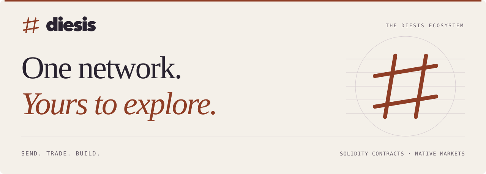

<picture>
  <source media="(prefers-color-scheme: dark)" srcset="https://raw.githubusercontent.com/0xDiesis/.github/main/profile/assets/diesis-dark.svg">
  <source media="(prefers-color-scheme: light)" srcset="https://raw.githubusercontent.com/0xDiesis/.github/main/profile/assets/diesis-light.svg">
  
</picture>

  <a href="https://github.com/0xDiesis/diesis-sdks"><b>Explore the SDKs</b></a> &nbsp;·&nbsp;
  <a href="https://github.com/0xDiesis/diesis-js#readme">Build with TypeScript</a> &nbsp;·&nbsp;
  <a href="https://github.com/0xDiesis/diesis-sol#readme">Write a contract</a>

## A blockchain with built-in tools for finance

Diesis brings together a network for sending money and trading, the apps people use to access it, and the tools developers use to build on it. Write Solidity contracts, compose with native markets, and let your app sponsor transaction fees.

<table>
  <tr>
    <td width="50%" valign="top">
      <h3>Markets in the protocol</h3>
      
Build on native spot order books and perpetual markets, with matching and settlement in the chain.

    </td>
    <td width="50%" valign="top">
      <h3>Your app can pick up the gas</h3>
      
Use Patron sponsorship to cover transaction fees for a sender, a contract, or a specific function.

    </td>
  </tr>
  <tr>
    <td width="50%" valign="top">
      <h3>Names people can read</h3>
      
Connect readable <code>.ds</code> names to addresses and records, with registration, renewal, and reverse lookup.

    </td>
    <td width="50%" valign="top">
      <h3>Familiar tools, more to build with</h3>
      
Use Solidity, Ethereum JSON-RPC, and your language’s Ethereum libraries to work with Diesis system contracts.

    </td>
  </tr>
</table>

## Build in your language

Start with an SDK’s README for installation and examples. TypeScript and Python include native RPC actions and signing helpers; the other SDKs provide contract bindings, interfaces, or event decoding.

| Web and services | Mobile, contracts, and data |
| :--- | :--- |
| [**TypeScript / JavaScript**](https://github.com/0xDiesis/diesis-js) · viem, wagmi, ethers, web3.js | [**Swift**](https://github.com/0xDiesis/diesis-swift) · web3swift |
| [**Python**](https://github.com/0xDiesis/diesis-py) · web3.py | [**Kotlin / Java**](https://github.com/0xDiesis/diesis-kotlin) · web3j |
| [**Rust**](https://github.com/0xDiesis/diesis-rs) · alloy | [**Solidity**](https://github.com/0xDiesis/diesis-sol) · system contract interfaces |
| [**Go**](https://github.com/0xDiesis/diesis-go) · go-ethereum | [**q / kdb+**](https://github.com/0xDiesis/diesis-q) · event decoding and analytics |
| [**F#**](https://github.com/0xDiesis/diesis-fsharp) · Nethereum | [**OCaml**](https://github.com/0xDiesis/diesis-ocaml) · ABI bindings and codecs |

## Around the network

The Diesis stack includes **Exchange** for trading, **Explorer** for inspecting chain activity, **Portal** for account tools, and **Faucet** for testnet tokens. **dsMPC** adds wallet signing policies and approvals; **MCP** gives agents scoped access to data and approved actions.

For work closer to the node, explore the [Diesis reth fork](https://github.com/0xDiesis/diesis-reth), [Verkle implementation](https://github.com/0xDiesis/diesis-verkle), and [EVM benchmark harness](https://github.com/0xDiesis/evm-benchmark).

---

  Greek δίεσις: the smallest interval in music. Diesis aims for the smallest interval between blocks.

